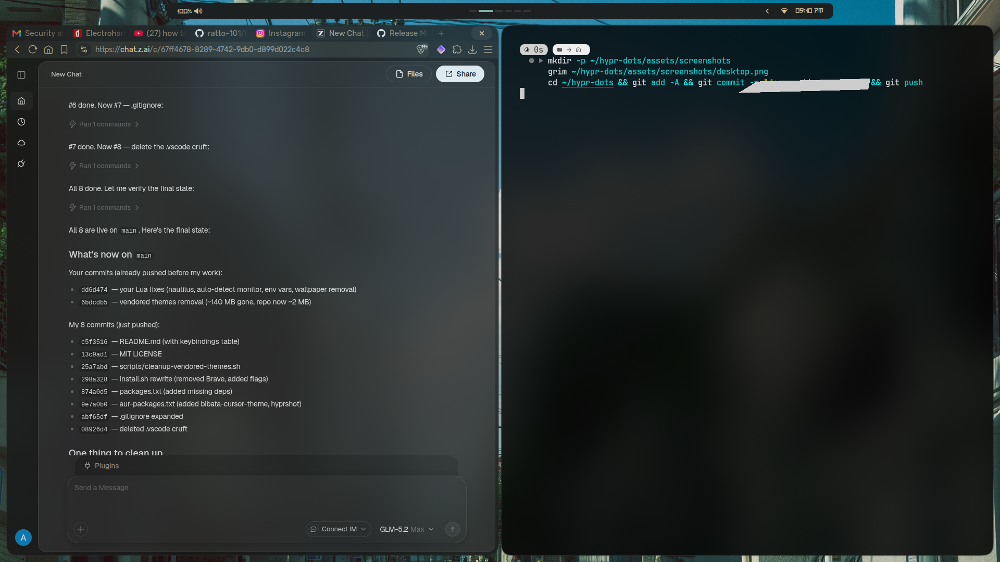

# hypr-dots

A Hyprland rice for Arch Linux, with Waybar, Rofi, SwayNC, Kitty, and a Gruvbox-inspired aesthetic.



## Features

- **Hyprland** compositor with custom animations, gaps, and blur
- **Waybar** with workspace switcher, audio visualizer (cava), system tray, network/clock/battery widgets
- **Rofi** app launcher and emoji picker
- **SwayNC** notification center
- **Kitty** terminal + Fish shell + Starship prompt
- **Fastfetch** / **btop** system info
- **Waypaper** wallpaper manager
- **Hyprlock** screen lock + **Wlogout** power menu
- Custom rofi-based menus for Wi-Fi, keybinds, and quick actions
- Bibata cursor theme

## Requirements

- **Arch Linux** (or Arch-based: EndeavourOS, CachyOS, Garuda, etc.)
- An **AUR helper** — `paru` or `yay` (the installer will install `yay` for you if neither is found)
- A display manager (SDDM, GDM, Ly) or a TTY to launch Hyprland from

> **Not on Arch?** You'll need to install the equivalent packages yourself (see `packages.txt` and `aur-packages.txt`), then run `./install.sh --no-deps`.

## Install (one command)

```bash
bash -c "$(curl -fsSL https://raw.githubusercontent.com/ratto-101/hypr-dots/main/install.sh)"
```

This will:
1. Clone the repo to `~/.local/share/hypr-dots`
2. Install all pacman + AUR dependencies
3. Back up your existing `~/.config/` to `~/.config-backup-<timestamp>/`
4. Symlink the rice's configs into `~/.config/`, `~/.local/bin/`, `~/.local/share/themes/`, `~/.local/share/icons/`

Then **log out** and select **Hyprland** from your display manager (or run `Hyprland` from a TTY).

## Install (manual clone)

```bash
git clone https://github.com/ratto-101/hypr-dots.git
cd hypr-dots
./install.sh
```

### Installer flags

| Flag            | Effect                                                    |
| --------------- | --------------------------------------------------------- |
| `--no-deps`     | Skip package install, only deploy configs                 |
| `--no-backup`   | Overwrite existing configs without making backups         |
| `--uninstall`   | Remove symlinks (backups stay in `~/.config-backup-*`)    |
| `-h`, `--help`  | Show help                                                 |

## Keybindings

| Key                    | Action                          |
| ---------------------- | ------------------------------- |
| `Super + Enter`        | Open terminal (Kitty)           |
| `Super + W`            | Open browser (Brave Origin)     |
| `Super + E`            | Open file manager (Thunar)      |
| `Super + T`            | Open text editor                |
| `Super + C`            | Open calculator                 |
| `Super + Space`        | App launcher (Rofi)             |
| `Super + Period`       | Emoji picker (Rofi)             |
| `Super + Q`            | Close window                    |
| `Super + F`            | Toggle fullscreen               |
| `Super + D`            | Toggle internal fullscreen      |
| `Super + Alt + Space`  | Toggle floating                 |
| `Super + J`            | Toggle split                    |
| `Super + Tab`          | Window switcher (Rofi)          |
| `Super + Arrow keys`   | Move focus                      |
| `Super + Shift + Arrow`| Move window                     |
| `Super + 1-0`          | Switch to workspace 1-10        |
| `Super + Shift + 1-0`  | Move window to workspace 1-10   |
| `Super + S`            | Toggle scratchpad               |
| `Super + Shift + S`    | Move window to scratchpad       |
| `Super + L`            | Lock screen (Hyprlock)          |
| `Super + Alt + C`      | Power menu (Wlogout)            |
| `Super + X` / `Super + A` | Toggle notification center   |
| `Super + V`            | Clipboard history (Rofi)        |
| `Super + P`            | Color picker (Hyprpicker)       |
| `Print`                | Screenshot full screen          |
| `Super + Print`        | Screenshot active window        |
| `Super + Shift + X`    | Screenshot selected region      |
| `Super + Shift + W`    | Wallpaper selector (Waypaper)   |
| `Super + Shift + P`    | Toggle power profile            |
| `Super + Shift + L`    | Toggle laptop mode              |
| `Super + Shift + M`    | Open rice quick-actions menu    |
| `Super + Shift + /`    | Open keybinds cheat sheet       |
| `Super + R`            | Restart Waybar                  |
| `Super + Shift + Esc`  | Open btop in Kitty              |
| `Ctrl + Alt + Delete`  | Power menu (Wlogout)            |

> **Tip:** Press `Super + Shift + /` anytime to see all keybinds in a rofi menu.

## Customisation

All configs are symlinked from `~/.local/share/hypr-dots/` into your `~/.config/`. Edit the files in the repo directory so changes survive updates.

| What              | Where                                          |
| ----------------- | ---------------------------------------------- |
| Hyprland config   | `~/.config/hypr/hyprland.conf`                 |
| Waybar modules    | `~/.config/waybar/config.jsonc`                |
| Waybar styling    | `~/.config/waybar/style.css`                   |
| Rofi theme        | `~/.config/rofi/gruvbox-material.rasi`         |
| Keybinds          | `~/.config/hypr/hyprland.conf`                 |
| Default apps      | `~/.config/hypr/hyprland.conf` (top variables) |
| Shell prompt      | `~/.config/starship.toml`                      |

## Uninstall

```bash
~/.local/share/hypr-dots/install.sh --uninstall
```

This removes the symlinks. Your original configs are preserved in `~/.config-backup-<timestamp>/`. AUR/pacman packages are left installed — remove them manually with `paru -Rs <pkg>` if you want.

## Notes

- The `.lua` files in `~/.config/hypr/` are from the original HyprMod (CachyOS) setup. They are **not loaded** by standard Hyprland — the `hyprland.conf` file is the active config. You can safely delete the `.lua` files if you don't use HyprMod.
- The installer uses `sed` to rewrite hardcoded `/home/ratto` paths to your `$HOME`. If you add new configs with hardcoded paths, the installer will fix them automatically on next run.

## Credits

- Built on [Hyprland](https://hyprland.org) by Vaxry
- Inspired by [CachyOS's default Hyprland config](https://github.com/CachyOS/cachyos-hyprland-settings) (the `.lua` files originated from there)
- Cursor: [Bibata](https://github.com/ful1e5/Bibata_Cursor)
- Fonts: [JetBrains Mono Nerd Font](https://www.nerdfonts.com/)

## License

MIT — see [LICENSE](LICENSE).
